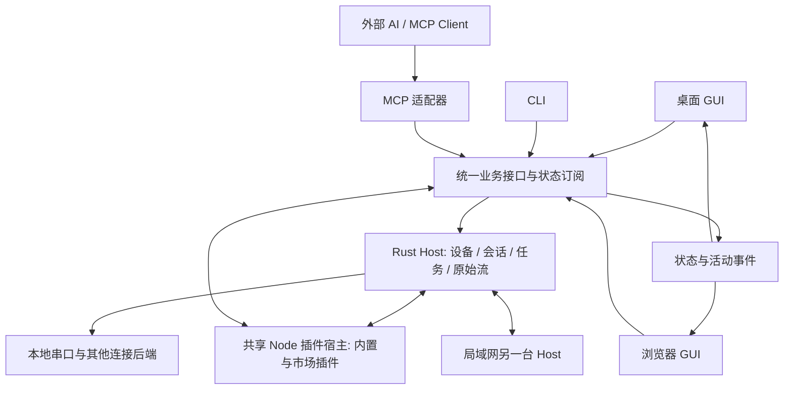

# Serial Workbench 全功能串口工作台重构设计

- 日期：2026-11-07
- 状态：需求与架构方向已确认；2026-11-07 用户要求依规划持续实施，作为执行基线
- 功能明细：[功能矩阵](./2026-11-07-serial-workbench-feature-matrix.md)
- 当前实现：[产品范围](../../product-scope.md)、[架构](../../architecture.md)

## 1. 产品目标与已确认决定

开发面向嵌入式调试、工业通信和设备测试的全功能桌面串口助手。常用功能安装后即可使用，专业能力由同一插件体系扩展。人、外部 AI 和自动化客户端共同操作一个工作台。

| 事项         | 已确认方向                                                                         |
| ------------ | ---------------------------------------------------------------------------------- |
| 产品形态     | Windows、macOS、Linux 桌面应用；保留 Tauri、React/TypeScript 与 Rust               |
| 功能来源     | 当前 HTML 的 218 个原编号、旧项目 28 项补充与 LAN-01 逐项追踪；保留别名和范围决定  |
| 能力分层     | 基座、内置 Node 插件、市场 Node 插件三部分                                         |
| 插件路线     | 统一 Node；M0 删除旧插件全部架构与配套资产，旧软件 API、数据格式和插件不做兼容     |
| 操作入口     | 桌面 GUI、浏览器、CLI、MCP 共用独立 Host 和业务接口                                |
| AI 体验      | 所有产品功能通过 MCP 开放；AI 每次操作时，GUI 跟随到对应页面、会话或面板并显示过程 |
| 浏览器       | 首批作为本机 Host 的客户端；零安装 Web Serial 版本列为后续扩展                     |
| 局域网       | 两台运行本软件的电脑直接共享串口，远端口在使用端像本地口一样工作                   |
| 信任体验     | 沿用旧设计的可信 Node 和一次信任；普通操作不反复弹授权                             |
| 本轮产品边界 | 聚焦桌面与外部 AI；不建设移动客户端、自有云平台或内置 LLM                          |
| 协作         | 当前 GitHub Flow、短期分支和 PR squash merge，保持 main 线性历史                   |

“所有功能”覆盖业务功能及设置、插件管理、工作区和界面导航。MCP 接口随功能一起交付，人工与 AI 两条路径一起验收；插件业务操作也必须登记到同一接口目录。

## 2. 参考项目与现有实现

| 来源                                                                                                                  | 核实结果                                                               | 采用的经验                                              |
| --------------------------------------------------------------------------------------------------------------------- | ---------------------------------------------------------------------- | ------------------------------------------------------- |
| [lilinng-163，8f496a7](https://github.com/lilinng-163/serial-workbench/tree/8f496a7de624f29945b6a57ca3a2486cac5a2718) | 35 个 MCP 工具，GUI/MCP 共享 Engine；部分工具依赖 UI，尚未覆盖全部 GUI | 共享会话、独立读取游标、操作可视反馈                    |
| [RE-TikaRa，392ca88](https://github.com/RE-TikaRa/SerialWorkbench/tree/392ca888cbe728e0d902f38c00316a039ba78367)      | 独立 Host、CLI/Agent JSON、写租约与任务；当前没有 MCP                  | 单一资源所有者、持久任务、稳定机器接口                  |
| 旧项目 develop `651a490`                                                                                              | 串口基础、最小 Text/HEX、工作区与录制回放                              | 选择性复用设备、原始流、采集、回执与状态模型            |
| 旧项目 handoff `ab226e8`                                                                                              | Node 仅固定参考插件，MCP 仅六个窄工具，发行 runtime/SDK 尚未完成       | 检查合同与失败场景；正式加载、全能力 MCP 和分发重新完成 |
| 当前仓库 `4c2dc63`                                                                                                    | 独立应用空壳；保留设置、窗口、主题、诊断及旧插件体系                   | 复用公共桌面体验，重新接入业务，整体替换插件体系        |

旧项目 239 项矩阵来自研究整合：218 个原编号合并 7 个别名，再加入 28 项补充。新矩阵保留全部 218 个编号，并在[旧项目补充需求承接](./2026-11-07-serial-workbench-feature-matrix.md#旧项目补充需求承接--28-条)逐项记录 28 项的归属、阶段与验收，加上 LAN-01 共 247 条追踪记录。别名共享实现，排除和后续项保留结论，追踪记录数单独统计。

旧方案的“AI 默认不切页”“插件可保持 UI-only”被本次全程跟随和全能力 MCP 要求替代。许可与协作按当前仓库的 Apache-2.0 和 GitHub Flow 维护。

### 与旧规划的承接

| 旧要求或取舍                           | 本轮结论                                                                                       |
| -------------------------------------- | ---------------------------------------------------------------------------------------------- |
| 先稳定基座，再按接口开发功能包         | 保留；M1 最小闭环用于验证，M3 通过代表场景后冻结首版 SDK，再开展 M4/M5。                       |
| 先完成软件，末期统一真机测试           | 保留；M6 依次完成软件候选、集中硬件验证与发行候选，软件阶段使用虚拟设备、PTY、回放及独立对端。 |
| 三平台及最低系统目标                   | 保留旧目标，见第 11 节；在 M0 核对新 Host/Node 工具链，不静默提高最低版本。                    |
| 离线 UART 波形分析、固件符号与崩溃解码 | 补回 DIAG-08/07，归内置 Node 分析/诊断包；物理采集设备另按市场适配。                           |
| 设备队列控制、超时、实验包与组合联动   | 以旧补充编号逐项承接，纳入 GUI/CLI/MCP 等效验收。                                              |
| 独立 Host、浏览器与 LAN                | 本轮新增或扩展；保留唯一资源所有者与同域状态。                                                 |
| 编码、专业协议/工具、完整脚本调试      | 按当前附件扩大目标；下文与矩阵指定首批变种和方向，后续版本在同一条目下扩充。                   |

旧库的“计划纳入”和“已有实现”分别核对：队列控制、配置不确定状态、BREAK 清线及录制前缀恢复已有生产代码与测试可作为回归依据；Node/MCP handoff 是带已知测试失败的源码交接，复用切片按本轮正式包与公共 SDK 重新验收。

## 3. 方案取舍与运行结构

已比较：以桌面进程为中心，接线较少，但持续任务和浏览器依赖桌面生命周期；独立 Host 增加服务边界，统一桌面、无头、浏览器与远程设备。用户选择独立 Host。

一个运行实例对应一个用户数据配置和一个 Rust Host，配套一份受监督的 Node runtime。客户端复用已有实例；首次使用启动 Host，实例发现与启动锁避免重复管理同一配置。

设备采集和插件任务由 Host 管理。关闭视图、切换标签或断开客户端后任务继续；“停止任务”“断开连接”“退出 Host”分别对应明确动作。桌面退出时显示在途任务，可选择停止或转为后台。

本地客户端通过当前用户可访问的 IPC 接入；本机浏览器使用 Host 提供的同源 HTTP/WebSocket 入口。浏览器服务默认绑定 loopback，经一次配对取得会话凭据，校验 Host、Origin 和 WebSocket 身份。局域网共享使用单独启用的认证入口。各入口复用服务端身份、资源权限和 handler；控制、批量原始数据、派生数据和界面刷新分开传输。MCP 使用标准 SDK 适配。

附着与重连先核对 Host 身份、运行实例代次、协议版本和能力目录版本。新协议同一主版本采用可选字段和能力协商，主版本不匹配时给出升级目标；客户端保留当前数据并等待切换。安装版本与协议版本分开，具体字段及支持范围在 M3 固定。该协商用于新 Host 客户端和两台电脑的版本差异，旧插件体系按第 12 节整体移除。

## 4. 三部分的职责

| 部分           | 承担内容                                                                                                                                                 | 分配理由                                           |
| -------------- | -------------------------------------------------------------------------------------------------------------------------------------------------------- | -------------------------------------------------- |
| 基座           | 设备发现与能力、连接生命周期、唯一发送仲裁、原始事件、录制回放、任务、工作区、状态订阅、插件宿主与信任、MCP/CLI、局域网共享、基本 Text/HEX、公共设置诊断 | 多个插件与客户端共同依赖，必须有单一所有者         |
| 内置 Node 插件 | 完整终端、编码搜索、命令库与编辑器、通用分帧与字段建模、Modbus/AT/NMEA、基础曲线仪表、脚本测试、常用传输、基本网络工具、离线 UART 分析与固件日志解码     | 开箱即用，通过正式插件验证基座 API，可独立维护启停 |
| 市场 Node 插件 | 专业协议、烧录与设备文件、BLE/HID/USB 适配、3D/地图/图像、高级分析、专业格式与数据库网关、仪器联动                                                       | 依赖、平台差异和体积较大，按需安装                 |

内置与市场插件使用同一 SDK、manifest、命令和状态契约，差别在默认安装、来源和更新渠道。第一方专业插件也可在市场发布。按领域组织少量包，一个包承载多个功能条目。

全部插件关闭后，基座仍能枚举、连接、Text/HEX 收发、记录回放、查看任务和诊断。

### 基座公开服务

| 服务                | 职责                                                          |
| ------------------- | ------------------------------------------------------------- |
| Device/Transport    | 本地与远程目录、能力、打开/配置/关闭、连接代次                |
| Session/Stream      | 字节、方向、序号、时间与缺口；独立游标、批量订阅              |
| Transmission        | 发送仲裁、队列等待/排空/定向清空、限速、租约和写入结果        |
| Capture/Replay      | 原始录制、分卷索引、完整性、只读回放、模拟数据源              |
| Operation/Job       | 在途任务、进度、结果、取消、重启后的中断状态                  |
| Workspace/Settings  | 配置、布局、会话和插件公开状态、复现实验包；持久化与 revision |
| Capability Registry | 动作、查询、事件、schema、GUI 定位及 MCP/CLI 发现             |
| Extension Host      | 激活、贡献、订阅、任务、升级和停用                            |
| Tool/Secret/File    | 外部工具交接、系统凭据、文件引用与导出                        |
| Remote Peer         | 配对、共享端口、远程租约、重连和跨 Host 事件                  |

### 资源与数据所有权

设备身份带来源 Host 命名空间；同一物理端口对应一个连接会话，多个标签、插件与客户端附着该会话并独立读取。克隆复制配置，选中同一端口时复用会话；配置不同进入显式变更流程。活动连接配置由资源所属 Host 写入，各视图的解码、过滤和选区可独立。

系统串口由 Rust 持有 OS 句柄。BLE/HID/USB 等扩展后端注册为 TransportProvider，可由插件 worker 持有实际句柄；Host 统一管理逻辑会话、发送仲裁、事件和关闭生命周期，界面与 MCP 继续使用同一连接接口。

传输声明流式或报文式语义；UDP 报文边界、WebSocket 消息类型等元数据与字节一起保留。接收块、协议帧和文本行分别建模。解码、分帧、字段、图表和脱敏导出属于派生结果；CRC/分帧算法可作为 SDK 公共库，协议事务策略由插件实现。

派生帧、字段和样本携带原始事件/字节区间、解析器版本与配置摘要、单位和质量标记。终端字节、字段表与曲线点可按这些关联定位。离线 VCD/带采样率的数字 CSV 使用独立 sample clock，UART 解码结果回链采样区间，支持错误起止位、校验与 BREAK；M3 用合成波形验证这条链，M5 完成文件导入与分析体验。

原始 RX 保存从后端收到、尚未解码或字符映射的字节。原始 TX 保存编码、字符映射、行尾及校验等处理后的最终字节，并关联写入回执：区分请求发送、后端接受的字节范围、部分写入和结果未知；对端应答由协议层确认。用户输入与变换参数另存为操作元数据。例如输入 LF 映射成 CRLF，TX 记录的是 CRLF，已接受范围由回执决定。回放以已确认的字节和结果状态为依据。

每个消费者有独立游标和有界队列。GUI 可合并刷新、图表可降采样，原始录制单独写盘；慢视图不向设备施加背压。录制或协议消费者跟不上时，按配置使用设备流控、停止任务或报告缺口。缺口携带序号范围，解码器与解析器据此重置，避免把缺口两侧拼成完整帧。状态订阅以带游标快照接续增量，游标过期明确返回重新取快照或从录制补读。

### 发送、任务与恢复

连接重开推进会话代次，配置变更更新 revision 并在数据流标记生效边界。普通发送、参数与控制线变更、协议事务和独占任务都由资源所属 Host 仲裁。协议事务从发送前一直持有租约到应答或超时，独占任务持续持有至结束；排队和实际写入前均校验租约与连接代次。外部烧录工具通过 Host 暂停普通会话并交接句柄，工具结束后重新打开并产生新代次。

配置回执分请求值、逐字段应用结果与实际读回。部分成功或结果未知时进入待确认状态，暂停新 TX 和相关发送任务；完成一次明确的完整配置后恢复。有限 BREAK 由持口端执行，到期、取消、错误和断开均先结算清线责任，再释放资源；assert/clear 分别记录，结果未确认时停止发送并暂停自动重连。

队列控制分别提供应用待发边界等待、OS TX 队列观察、驱动排空及 RX/TX 定向清空。等待可取消，超时保留实际状态；清空报告方向、范围及未知结果，保留已记录的历史与发送事实，并标记流连续性变化。读等待、写等待、字节空闲、协议应答和重连退避各用独立超时字段，页面与 MCP 使用相同语义。

有副作用的请求使用操作者、请求 ID、目标及参数摘要去重，重连和 A→B 转发保留同一请求身份。相同 ID 与参数返回已有 operation，不同参数返回冲突；执行端记录接纳与结果。结果记录到期返回已过期，不能按新请求重发；Host 在写入后崩溃且未保存结果时标为未知。断线、超时和恢复先查询结果。

任务记录执行 Host、发起者、资源、输入、依赖插件版本和终态；取消由任务负责人完成并发布结果。配置保存会话参数与布局，运行中的发送队列和任务不随配置恢复执行。回放默认只读，向设备重放和设备模拟分别建立显式任务。

录制提供原始记录与脱敏记录两种模式：原始记录用于逐字节复现，可加密保存；脱敏记录标记已变换。用户选择脱敏时，未经选择不另存未脱敏副本。

录制分别显示已写、flush、sync 和独立读回验证的水位；完整终态在分卷及索引验证后发布。损坏或中断录制提供“验证 → 预览可恢复边界 → 另存已验证前缀”，恢复文件标记不完整；原件只读，目标碰撞和验证后源变化返回冲突，保留已有数据。工作区可导出复现实验包，包含配置、插件/解析器版本、录制引用、设备/固件标识与执行结果；共享时预览并去除密钥和所选敏感内容。

## 5. 人与 AI 共用工作台

### 一份业务定义

每个功能登记稳定 ID、输入输出 schema、目标资源、执行位置、权限、状态投影、事件、取消方式与 GUI 定位。人工、CLI、MCP 和插件调用同一 handler，提交状态后通知各客户端。基座状态由 Rust 服务拥有，插件业务状态由后台任务拥有并经 Host 投影；关闭视图后仍可查询和操作。

例如 AI 关闭启动检查更新，Host 更新设置与 revision，两种 GUI 开关同步；人停止录制，AI 查询同一 operation 得到终态。AI 打开已有串口复用会话，配置不同则明确处理冲突。

设置、连接、任务、插件配置和工作区内容是共享状态；每个窗口的活动页、焦点、滚动和跟随状态留在客户端。布局以工作区模板保存，各窗口独立使用。正在编辑的草稿保留在客户端，外部修改时按 revision 检查冲突并提示合并。

### 全程跟随

- 默认跟随当前 AI 会话，绑定一个观看窗口；其他窗口可自行加入跟随。每次功能调用，包括查询，携带 `revealTarget`：工作区、会话、页面、面板与结果对象。
- 开始时定位并显示输入，运行中显示进度，结束后显示结果或错误；同一任务的轮询、推送和内部子步骤更新当前面板。并行操作列入活动列表，按调用开始顺序定位，迟到结果更新所属记录；凭据字段只显示引用。
- 导航、设置和插件管理也是明确操作。插件提供定位映射，保证可调用的功能在 GUI 中有对应呈现。
- 切页保留编辑草稿，不自动提交或覆盖。显示当前操作者；“暂停跟随”只暂停导航，“人工接管”暂停该 AI 对目标资源的新修改，停止其排队写入并结算在途任务后交还控制。“恢复跟随”和重新授予控制分别执行，旧队列保持终结。
- 多个 AI 接入时选择一个作为观看对象，其他操作仍同步状态与活动。A 上的 AI 默认导航 A 的观看窗口；B 显示远端活动和状态，自行选择是否观看该操作者。
- 无头运行使用同一业务接口；打开 GUI 后恢复当前任务与最近活动。观看模式可启动桌面界面，无头批处理保持后台。

导航、剪贴板、窗口及系统交互定位到具体客户端，由客户端适配器执行并返回结果。没有相应客户端时返回所需客户端能力；数据处理、导出和业务任务可独立执行。图表/选区导出使用可离屏调用的渲染入口，M3 以一个图表导出验证，不依赖已打开的插件页面。

### MCP 和 CLI

基座与插件从同一注册表生成可发现接口，正式业务操作提供独立于视图的 handler。首批提供 STDIO 入口附着本地 Host；HTTP MCP 按客户端需要启用，具体协议版本按 Codex 等目标客户端核对锁定。

接口按领域和插件命名，发现结果覆盖当前安装且已授权的功能。MCP 适配器独立于插件宿主运行，插件故障后仍可查询状态、停止任务和管理插件。

能力目录保留稳定排序、版本和分页，安装、启停或升级插件后按目标协议通知工具清单变化；目标客户端未刷新时可重新连接获取清单。全能力开放通过明确的领域工具和 schema 实现，插件动作不退化为任意代码执行。以实际 Codex 等客户端验证发现、调用、长任务、取消和工具更新。

长任务返回 operation ID，支持进度、结果和取消；重连使用快照与事件游标。原始数据按时间/序号/长度读取，大结果返回文件或结果对象引用。

MCP 接入时一次确认工作区、设备与读写范围，普通动作复用；目标或执行范围变化时更新信任。服务端按请求身份执行权限检查，插件内部代表调用者触发的动作保留该身份。插件安装、任意 JS/TS/外部命令执行另属代码执行或管理授权；普通串口读写授权只允许已登记的相应操作。可信 Node 的完整 OS 权限与外部客户端的 API 授权分别管理，脚本执行授权意味着允许代码以运行 Host 的用户身份执行。

外部客户端首次接入可查询元数据和限量脱敏摘要；原始流、日志、文件正文及设备修改分别建立可复用授权。数据范围统一覆盖动作结果、快照、进度、事件、错误和导出文件引用，读取结果引用时重新校验身份与权限。串口内容、终端序列、插件输出与导入文件保留来源标记，作为业务数据处理；授权由用户控制入口建立。终端的剪贴板写入、自动外链与序列触发文件操作单独控制，避免查看设备输出触发额外动作。

## 6. LAN-01：两台电脑之间使用远程串口

首批架构场景：B 拥有物理串口，A 在自己的工作台使用该端口；两端均运行本软件，通过局域网直接连接。

1. B 开启共享，选择端口及访问方式。
2. A 通过局域网发现或手动地址找到 B，首次用配对码确认并记住对端身份。
3. A 设备列表显示“电脑 B / COM7”等远端口，可以保存连接配置。
4. A 使用与本地一致的收发、参数、终端、解析、图表、脚本、录制和 MCP。
5. B 的 Host 唯一持有 OS 句柄，执行配置与发送；A 转发操作、接收原始事件和状态。B 同步显示连接者、参数与活动。
6. 断网后显示连接和缺口，恢复时核对会话代次与游标；未确认的写入不自动重发。

提供观察和控制访问：多个观察者独立订阅，发送和协议事务通过 B 的同一仲裁。传输/烧录取得独占租约，两端显示占用者，设备所在电脑可以人工接管。

普通发送有序排队；协议事务、参数修改和独占工具使用明确租约，控制者之间的事务不交织。B 接管时先终止远端的新写入，结算已开始的写入后转交本地。关闭共享只释放远端访问，B 自己仍在使用的连接与录制继续。

共享显式开启，配对确认对端密钥身份后使用认证加密连接；发现只提供候选地址，身份仍以配对记录为准。B 按已共享设备和观察/控制范围处理每个请求，A 的本地授权不能扩大 B 的共享范围。运行 B 端脚本、安装插件或调用外部工具需要 B 额外授予对应执行范围，普通串口共享保持设备级授权。

远端任务区分两种执行方式，创建时显示执行电脑与断网行为：

- **A 驱动的交互流程**依赖有时限、可续期的控制租约。A Host 失联后，B 在租约到期时结束该流程、取消尚未执行的写入并回收控制；重连后重新申请，已发字节按回执处理。
- **B 已接受的独立任务**由 B 继续执行，例如录制、传输或烧录；任务持有自己的租约，A 断线后仍可在 B 查看或停止，A 重连按 operation ID 取结果。B 撤销共享或人工接管会主动停止远端发起任务，按工具可取消点结算；B 本地发起的任务继续。

关闭 A 的 GUI 不等于 A Host 失联。B Host 重启后，未完成任务标记中断或结果未知，自动发送任务由用户重新启动。

录制标记来源为 B。B 可保存权威原始录制，A 可保存本地副本；副本记录原始序号与网络缺口。时间线保留源端单调时间、墙钟与接收时间，显示 RTT 和时钟偏移估计及误差范围；跨机排序使用这些信息，源端序号保持原义。

连接代次、原始序号、租约和发送回执以 B 为权威，A 转发时保留来源、操作者和请求 ID。时序敏感的分帧、控制线、协议事务和设备工具在 B 执行；通用解析和图表可在 A 运行。任务创建时固定执行位置和依赖版本，输入文件通过 Host 文件引用传递，A 的本地路径不作为 B 的路径使用。需要 B 端插件或工具的操作先发现其版本和可用性，缺少时引导安装对应组件，两端分别建立插件信任。

验收：A/B 同时观察、A 改参数与发送、双方 UI 同步、A 上的 MCP 操作、多观察者、事务占用、B 接管、断网/重连/重启、交换两机角色。RFC2217 另作与第三方串口服务器互通的后端。

## 7. Node 插件与信任体验

借鉴 VS Code 的独立扩展宿主、延迟激活、`package.json` 贡献声明和 SDK，采用本项目 API 与市场，使用 JS/TS 和 npm 生态开发。

共享 Node 主宿主承载可信插件，负责激活、登记和轻量编排；用户脚本、持续解析和重计算从起点就在可终止的 worker 或子进程中运行。任务由 Host/job 管理，页面订阅状态。单 worker 故障结束其任务；主宿主无响应时监督器重启该宿主，相关插件任务标记中断并重新登记贡献。Rust 自持串口和原始录制继续；插件持有句柄的连接后端则报告断开，按新代次恢复。

正式包携带构建后 JS、锁定依赖、资源与 manifest，支持离线安装，安装过程不执行 npm install/postinstall。native addon 和外部工具按 OS/架构分包，锁定 runtime/ABI 与工具版本。

M0 固定随包 Node 的精确版本、上游来源和 hash，M2 按应用内固定路径启动并验证完整性，用户环境的 PATH 不参与 runtime 选择。各平台 runtime、native addon、工具的来源和许可随包记录，最终发行组合按平台处理签名与公证。

manifest 声明版本、宿主 API、Node 后台入口、可选 Web UI 入口、依赖、动作/查询、连接后端、解析器、视图、主题和配置。业务贡献提供 schema、状态及 GUI 定位；MCP/CLI/GUI 覆盖一起检查。激活/卸载统一 register/dispose 生命周期。

插件后台拥有业务任务、解析器和可查询状态；UI 携带预构建的 HTML/CSS/JS，默认在受控 iframe 中承载自由布局，可使用 React 等框架。桌面 WebView 与普通浏览器加载同一份 UI，消息桥复用动作与订阅契约，UI 仅持有编辑草稿和呈现状态，不依赖 Node 或 Tauri 全局对象。关闭页面只释放视图订阅；重新打开从快照与游标恢复。终端和图表在 M2 验证焦点、输入法、键盘、主题、离屏导出和大数据传递，再固定 UI SDK。该前后台划分借鉴 [VS Code Webview](https://code.visualstudio.com/api/extension-guides/webview) 的独立上下文与消息通信。

第一方随包插件建立产品信任；市场和本地包首次启用确认来源及完整 Node 执行权限，之后普通操作直接执行。Node 按当前用户 OS 权限运行，进程监督提供稳定性；附件 SEC-03 按已选路线调整为可信运行和明确停用。JS/TS 为内置语言，Lua/Python 可由专用插件管理外部运行时。

导入项目、打开录制、生成脚本和加载示例只准备内容。运行自由脚本需已有明确的代码执行授权，并记录实际代码版本；范围内复用信任，代码来源或执行范围变化时更新。MCP 生成与执行分别作为动作，授权建立由用户控制。

升级停用先停止接纳新任务，结算或中断旧任务、释放贡献，再激活新版。私有数据与安装包分开保存，API 和数据格式分别版本化。同一可信发布者、相容 API 的升级复用已有信任；来源或签名身份变化重新确认。签名证明包来源和完整性，执行权限由用户的信任决定。

市场首版使用仓库托管目录与公开评价记录，评分显示统计口径、来源和更新时间；提交评价跳转对应 GitHub 讨论。客户端提供搜索、签名验证、版本管理和安装升级，复用现有 GitHub 身份体系。

## 8. 浏览器客户端

复用 React 工作台、动作、状态和插件视图，在客户端适配器后区分桌面 IPC 与网络调用。首批由本机 Host 提供网页和同源 API，浏览器一次配对后操作同一实例；A 的浏览器经 A Host 使用 B 的共享串口，沿用 LAN 权限和任务规则。

串口、插件、录制与工具在 Host 所在电脑执行。浏览器上传、下载与选择文件映射为文件操作；标题栏、托盘和窗口管理保留桌面实现。两种 GUI 的业务行为和 AI 跟随共同验收。

FUT-08 的零安装 Web Serial 版本保留后续，届时新增浏览器设备适配和支持矩阵；本轮共享 Host 形态单独记录。

## 9. 模块组织建议

| 模块            | 建议位置          | 内容                                                                             |
| --------------- | ----------------- | -------------------------------------------------------------------------------- |
| Rust 领域核心   | `crates/core/`    | 设备、流、发送、采集、任务、工作区、注册表                                       |
| 独立 Host       | `crates/host/`    | 生命周期、IPC/API、远端共享、Node 监督                                           |
| Tauri 桌面      | `src-tauri/`      | 窗口、托盘、系统集成、Host 客户端                                                |
| 共用 GUI        | `src/`            | 工作区、会话、插件视图、活动和跟随                                               |
| 客户端/扩展契约 | `packages/`       | 适配器、schema、SDK、打包工具                                                    |
| Node 宿主       | `extension-host/` | 激活、贡献、数据路径、任务与 worker                                              |
| 内置插件        | `extensions/`     | terminal、protocol、charts、automation、transfer、network、analysis、diagnostics |
| 独立市场        | `marketplace/`    | Node 包目录、审核、签名、发布及专业插件                                          |

目录在提取模块时落定。公开契约统一生成客户端类型和运行时 schema；Rust 静态服务与插件动态贡献进入同一注册表。具体生成/序列化工具由首批纵向场景验证。

## 10. 开发顺序与阶段验收

先完成真实纵向场景和基础接口，再并行扩展功能包。

| 阶段                | 交付                                                                                              | 进入下一阶段的条件                                                              |
| ------------------- | ------------------------------------------------------------------------------------------------- | ------------------------------------------------------------------------------- |
| M0 设计与契约       | 218 原项、28 旧补充与 LAN-01 矩阵；旧栈全清理、服务/流/状态/插件契约、三平台基线                  | 设计确认，每项有归属、阶段和验收方向；Host 与 Node 分发约束明确                 |
| M1 设备与最小工作区 | 独立 Host、Virtual/PTY/OS 串口、Text/HEX、设置、发送回执、原始录制/只读回放；GUI/CLI/MCP 首条闭环 | GUI/MCP 操作同一会话；UI 卡顿不阻断采集；停止退出可结算                         |
| M2 Node 与多客户端  | 正式包加载和 runtime 分发、后台/Web UI SDK、浏览器、LAN-01、AI 全程跟随、三类参考插件             | 三平台最小包离线启动；终端/图表/自动化走公开 API；两 Host 互联、权限与 GUI 同步 |
| M3 基座契约 v1      | Modbus 事务、传输独占、长脚本、离线波形、离屏导出、采集与远程接口；冻结全新公开契约               | 第 11 节冻结检查通过；真实参考覆盖公开 SDK、故障/恢复/预算与三平台软件路径      |
| M4 内置功能包       | 常用终端、命令、协议、可视化、自动化、传输、网络与诊断                                            | 对应条目有 GUI/MCP 等效测试与结果                                               |
| M5 专业插件与市场   | 离线分析/固件解码补齐；烧录、专业连接与协议、仪器、3D/地图/图像、高级导出及市场分发               | 软件对端/文件/工具验证功能，安装升级和 SDK 合同通过；硬件验证集中到 M6          |
| M6 整体验收         | 软件候选 → 集中硬件验证 → 发行候选；三平台安装、72h、常见硬件及局域网双机                         | 先完成全部纳入软件项，再统一真机调整；每步独立记录完成状态，正式分发沿发布流程  |

M2 内按 Node 后台/界面与分发 → 浏览器与 GUI 跟随 → LAN 纵向闭环拆成可验收的小步，每步复用 M1 的真实设备与任务路径。M1/M2 参考功能继续演进为正式产品；M3 后可按领域独立开发内置与市场包。按用户 2026-11-07 的执行要求，接口就绪且文件范围独立的任务尽量并行；注册表、SDK、数据格式和锁文件串行集成。真实需求可调整公开接口，同时更新调用者与合同测试。

M3 冻结新体系的首版受支持契约及错误、数据、资源生命周期。后续相容扩展按能力发现接入；破坏性变更提升契约版本并更新 SDK、调用者、数据处理和互通测试。完整功能包在此门之后扩展，避免各自依赖临时私有接口。

## 11. 验证策略

### 贯穿场景

1. Text/HEX、编码任意拆块、发送变换后字节与实际 TX/回执一致；部分写入和未知结果可重现。
2. 多口、两个 GUI 与 MCP 共同操作，设置和任务一致。
3. AI 操作终端/设置/插件/图表，指定 GUI 定位并显示结果；草稿保留、暂停跟随与人工接管分别验收。
4. Modbus 主从、超时和迟到响应，发送事务不混入。
5. 采集同时搜索、绘图和执行脚本，关视图后继续任务与录制。
6. 传输/烧录独占、取消、断开和结果恢复。
7. 插件/Node 崩溃、客户端断开、Host 异常后的任务和文件状态。
8. LAN-01 与浏览器，断网、认证失效、共享撤销、重新连接；交互租约到期与 B 独立任务继续分别验证。
9. 无 Node/Tauri 的插件 Web UI、视图关闭后业务继续、无头图表导出；代码执行与设备读写授权分别验证。
10. 不同协议版本、旧浏览器页面和带后台任务的升级；任务结算后全套发行组件切换。
11. 合成离线 UART 波形、错误起止位、采样缺口及大文件，解码结果关联源采样区间。
12. 队列等待/排空/定向清空、部分配置暂停 TX、BREAK 清线，以及跨卷录制验证和前缀另存。

附件 T01—T14 对应字节、终端、生命周期、线路、日志、背压、解析、回放、脚本、图表、网络、传输、插件和安装，随功能矩阵落实。

### M3 契约冻结检查

- 上述场景以真实参考实现、独立对端或合成金样运行；终端、图表、自动化、网络/工具交接与离线波形共同验证公开契约。
- 至少两个不同参考插件只使用公开 SDK；类型、运行时 schema、错误和版本门一致。
- 三平台原生软件路径、正式 Node 包离线启动、无界面数据消费、插件故障回收、原始流与停止通道预算通过。
- GUI/CLI/MCP 同一动作及数据授权、revision 冲突、旧代次、撤权、取消和未知结果通过；至少一个实际 MCP 客户端完成闭环，其余目标按兼容矩阵继续验证。
- 录制写盘失败、验证水位、跨卷前缀恢复、工作区冲突及未来格式处理通过，数据原件保留。
- 新 runtime/SDK/manifest、旧体系清理、接口文档及性能基线落地，再进入 M4/M5 功能包集成。

### 性能和容量

固定 release 构建与参考机器，测量完整进程树。初始软件负载建议为单会话 11520 B/s、4 会话各 100 KiB/s、8 会话各 1 MiB/s 压力；记录原始计数/hash、队列、控制延迟、CPU/RSS、句柄和磁盘吞吐。典型负载进行 72h 长稳。

3/6/12 Mbps 在支持相应速率的适配器与对端上验证；百万点/60FPS 按通道、可见窗口、采样与降采样记录。队列满载报告缺口或停止原因，控制与停止通道保持可用。M1/M2 实测后固定参考机器、预算和阈值。

### 平台和硬件

先用 Virtual、PTY、loopback socket 与参考对端完成软件开发，再集中真机验收。继承旧规划的兼容目标如下，M0 核对 Host/Node/WebView 工具链并固定构建与测试版本：

| 平台            | 兼容验收目标                                                 | 发行物                                    |
| --------------- | ------------------------------------------------------------ | ----------------------------------------- |
| Windows x64     | Windows 10 22H2；Windows 11 24H2/25H2，26H2 进入新增测试清单 | NSIS 主包，MSI 与便携 ZIP 各自验收        |
| macOS arm64/x64 | macOS 14 作为最低测试边界，两种架构分别构建与运行            | 分架构 app/DMG，正式分发完成签名和公证    |
| Linux x64 glibc | Ubuntu 22.04/24.04、Debian 12 作为基础测试目标               | deb 与 AppImage，在最低目标环境构建并测试 |

最低系统和发行格式的调整记录为范围变更；发布说明列实际验证版本。三平台原生 WebView 与浏览器分别检查，软件候选完成后统一开展下面的硬件矩阵。

硬件覆盖 CH340/CH341、CP210x、FTDI、PL2303、CDC ACM 及 TTL/RS232/RS485；按能力测流控、控制线、速率、休眠、拔插和同型设备。旁路监听、自动波特率与仪器同步分别指定代理/驱动/采样硬件。LAN 最终用两台物理电脑测试并交换角色。

## 12. 重构影响和清理

保留公共桌面壳、设置同步、窗口协商、中英文、主题、诊断和更新框架。旧设备/领域/采集代码选择性提取，解除旧视图耦合，再接入当前命令与生成类型。

替换范围包括 Rust 插件模块、Extism/Wasmtime 依赖与 vendor 补丁、worker 参数、原生注册/绑定、前端插件 Provider 和页面桥、SDK、包格式、市场构建/签名/发布、示例、fixture、CI 与教程。M0 在进入 M1 前以依赖树、入口搜索和生产构建完成全部旧栈清理；新 Node 在 M2 按公开合同重建，M3 核对新体系安装包与契约一致。

GUI、Host、CLI/MCP 适配器、Node runtime 和随包插件作为有兼容声明的一套发行组件，安装包自带所需运行时，用户无需另装 Node/npm。M2 在三平台验证离线启动与插件加载，M3 验证后台升级：先下载到新版本目录，附着旧 Host 协商停止新任务并结算在途任务，退出相关进程后切换整套组件。用户可推迟切换继续录制；失败保留旧安装和用户数据，旧程序遇到较新数据格式按现有恢复规则处理。旧浏览器页面在重连握手后提示刷新。

重构后的新插件仓库和格式从首版开始，不迁移旧插件包、授权及缓存。当前合理公共设置/原子写入/revision/未来格式保护职责保留；旧软件接口、数据格式与插件状态不读取迁入，不为旧设计保留适配。已有用户磁盘原件不通过源码清理删除。主库与 marketplace 的 Node 格式变更配套落地，M0 同步修订当前指南与 ADR 的有效结论，清理旧体系入口，Git 历史保留变更依据。

安装文件与用户内容分开。录制、工作区与插件数据明确新格式版本；合理算法与职责按新合同选择性复用，不迁入旧界面、旧 API 或旧数据格式兼容。应用与市场采用 Apache-2.0，保留实际第三方许可；选库核对许可、平台、离线打包、维护与体积，分发按[构建与发布](../../build-release.md)执行。

## 13. 依据

- 当前附件：`开源串口工具功能大全与设计参考.html`，17 类 218 项及 T01—T14；矩阵保留其定义。
- [Qt 共享 Engine 与 GUI/MCP](https://github.com/lilinng-163/serial-workbench/blob/8f496a7de624f29945b6a57ca3a2486cac5a2718/src/app/main.cpp#L145)、[MCP 注册](https://github.com/lilinng-163/serial-workbench/blob/8f496a7de624f29945b6a57ca3a2486cac5a2718/src/mcp/mcp.cpp#L600)。
- [.NET Host 接口](https://github.com/RE-TikaRa/SerialWorkbench/blob/392ca888cbe728e0d902f38c00316a039ba78367/src/SerialWorkbench.Ipc/RpcContracts.cs#L63)、[任务和重启恢复](https://github.com/RE-TikaRa/SerialWorkbench/blob/392ca888cbe728e0d902f38c00316a039ba78367/src/SerialWorkbench.Host/OperationManager.cs#L33)。
- 旧库 `serial-workbench-old`：`docs/adr/0026-trusted-node-domain-control.md`、2026-11-02 产品设计、设备/领域/采集及 handoff 参考；按第 2 节提交核对。
- 旧需求承接按 `develop@651a490` 的 239 项 JSON 与产品设计核对；生产回归参考 `domain/serial_control.rs`、`serial_break.rs`、`serial_desktop/recording.rs`、`replay.rs` 及相邻测试。旧的状态和验收结果只作为迁入依据，新主线按当前提交重新验证。
- [VS Code 扩展宿主](https://code.visualstudio.com/api/advanced-topics/extension-host)、[manifest](https://code.visualstudio.com/api/references/extension-manifest)、[Web 扩展差异](https://code.visualstudio.com/api/extension-guides/web-extensions)。
- [MCP 标准传输](https://modelcontextprotocol.io/specification/2026-07-28/basic/transports)、[TypeScript SDK v2.4.0](https://github.com/modelcontextprotocol/typescript-sdk/tree/v2.4.0)。
- [MCP 工具目录、schema 与清单变化](https://modelcontextprotocol.io/specification/2026-07-28/server/tools)：协议支持按锁定版本及实际目标客户端验证。
- [Web Serial](https://developer.chrome.com/docs/capabilities/serial)：浏览器直接连接设备的后续形态，与本轮 Host 客户端分别验收。

实施拆分见 [M0—M6 推进计划](../plans/2026-11-07-serial-workbench-roadmap.md)，首阶段的文件范围、依赖、任务、检查和提交点见 [M0 契约与执行基线计划](../plans/2026-11-07-m0-contracts-and-baseline.md)。
